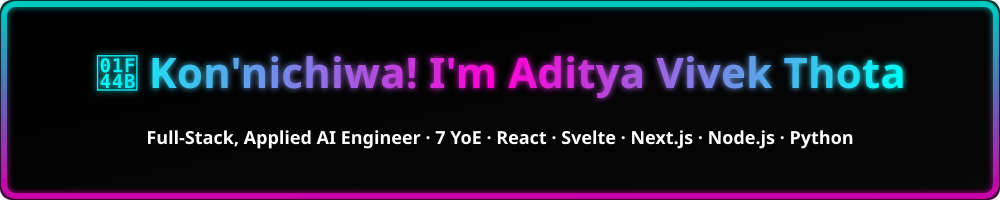
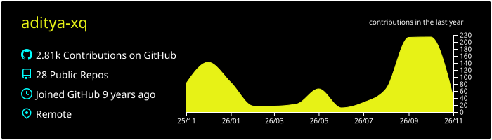

  

  
  

### 🌱 Personal Philosophy  
> “If you ask me a question and I don't know the answer, I'm gonna tell you that I don't know.  
> But I bet you what? I know how to find the answer — and I **will** find the answer.”  
> — *The Pursuit of Happyness*

## 🤝 Work With Me

- 🤖 AI-powered productivity & automation systems  
- 🧠 Applied AI + Full-stack apps (React, Next.js, SvelteKit, Node, Python)  
- ✍️ High-quality engineering writing for developer-focused blogs  
- 🛠 Consulting on systems design, frontend architectures, and AI-enabled workflows  

Give me a **problem, vision, or desired outcome** — I’ll figure out the rest.  
Tech-agnostic. Context-first. Results-driven.

## 📬 Contact  
**📧 Email:** adityavivek.xq@gmail.com  
**🔗 Best for collaborations:** DM on LinkedIn - https://www.linkedin.com/in/aditya-vivek-thota  
**🌐 Portfolio:** https://aditya-xq.github.io  
 

✨ Thanks for stopping by! May the force be with you.

